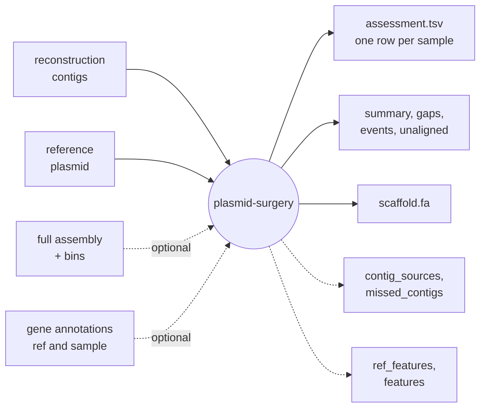

# plasmid-surgery

A plasmid reconstructed from a short-read assembly is usually a set of contigs, without their order,
orientation, or any indication of what's missing. **plasmid-surgery** assesses such a reconstruction
against a reference plasmid: where each contig belongs, which parts of the reference are covered,
which gaps are repeats and which are missing sequence, what the sample has that the reference
doesn't, and, given the full assembly, where the rest of the plasmid ended up.

## What it reports

| Question | Where |
|---|---|
| How much of the reference does the reconstruction cover? | `assessment.tsv`: `ref_fraction_covered`, and with repeats counted, `ref_fraction_covered_including_repeats` |
| Where is each contig, and in which orientation? | `summary.tsv` |
| What's missing, and is it a collapsed repeat or genuinely absent? | `gaps.bed`: gaps typed `repeat` or `unique` |
| What does the sample have that the reference doesn't? | `events.tsv` (insertions), `unaligned.fa` |
| Is the missing sequence elsewhere in the assembly, and in which bin? | `contig_sources.tsv`, `missed_contigs.fa` (with `--assembly`) |
| Are the reference's genes in the reconstruction? Are the sample's genes where the reference has them? | `ref_features.tsv`, `features.tsv` (with annotations) |
| What does the plasmid look like, in reference order? | `scaffold.fa` |

## Where to start

* [Getting started](getting-started.md): install, and a first run.
* [Finding references](concepts/finding-references.md): `plasmid-surgery-refs` finds candidate
  references in a plasmid database (a mash sketch and its FASTA).
* [Concepts](concepts/alignment.md): how contigs are placed, and how coverage, gaps and the
  scaffold are worked out.
* [Behaviour report](behaviour/index.md): each of the main design decisions, and its trade-offs,
  demonstrated on a small simulated plasmid. Every claim in it is checked by a test.
* [Reference](reference/outputs.md): every output file and field, the command line, and the
  Python API.
